<picture>
  <source media="(prefers-color-scheme: dark)" srcset="assets/terminal-escuro.svg">
  
</picture>

### `$ ls ~/projetos`

- **[`graduacao-bsi-ufu`](https://github.com/Cadu-Pechiori/graduacao-bsi-ufu)**: meus trabalhos da graduação, organizados por período e disciplina, com um resumo de cada um.

### `$ cat ensino-e-comunidade.txt`

- Videoaulas de C para colegas de Introdução à Programação (vetores, matrizes, ponteiros, structs e arquivos) e videoaulas de Prolog e Árvore AVL.
- Tutor no programa de tutoria do curso, minicurso de UI/UX Design no PET-SI (FACOM Techweek) e curso de Lógica pelo DACOMP.
- PET-SI, DACOMP e Atlética AAACOMP, cuidando de design e comunicação.

### `$ echo $CONTATO`

**cpechiori@gmail.com**
